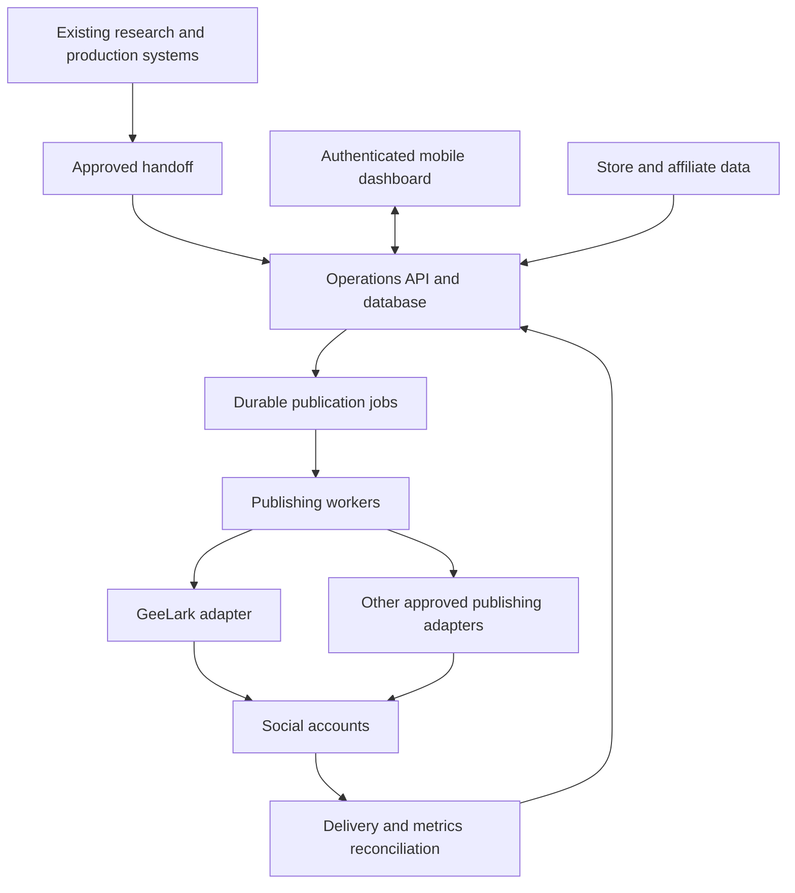

# Multi-brand operations architecture

Status: proposed design, 2026-10-19. This describes the system to build; it
does not claim that the dashboard, database, workers or integrations exist.

## Purpose and boundary

One internal operations platform serves many brands and social accounts.
Existing research, strategy, production and editing tools remain their own
systems. Distribution receives their approved output and returns delivery,
cost and performance records using the same asset identifiers.

The first customers of this internal platform are our own brands. The model
also accommodates an outside client's brands without requiring us to sell
the software or duplicate the system for every client.

The service unit is a **managed account with a defined publishing workload**.
A brand can have many accounts; a piece of content can have many intended
publications; every publication has its own outcome and cost.

## Logical system



GeeLark and proxies are replaceable execution resources. The platform owns
the account directory, publication intent, history and reporting. No vendor's
task list becomes our only record of what was meant to happen.

## Ownership model

```text
Operator: our team manages the platform
  Workspace: an owning business or client; the tenant boundary
    Brand
      Audience property: a distinct account family, purpose, market and language
        Social account: a specific Instagram, TikTok or YouTube identity
          Publication: one intended post to that account
```

One owner may have several brands in one workspace. Separate clients get
separate workspaces. Operator access across workspaces is explicit and
audited. Team memberships can be restricted to particular brands and actions.

An audience property groups related platform accounts; it does not imply
that their followers are the same people. Accounts need an identifiable job
from upstream strategy. An arbitrary quantity of accounts is not a design
requirement.

Country fields are distinct: intended market, business/account eligibility,
publishing timezone, device location and observed proxy egress. None is a
substitute for the others or a promise about audience geography.

## Records and their authority

| Record | Owns |
|---|---|
| Workspace and membership | Ownership, access, budget, service agreement |
| Brand reference | Existing brand-folder identity, store connections and brand-level permissions |
| Audience property | Upstream purpose, intended market/language, related platform accounts |
| Social account | Stable platform ID, current handle, owner, lifecycle and recovery contact reference |
| Provider connection | Provider account, secret reference, capabilities, rate and spend limits |
| Resource binding | Account-to-connection/device/proxy mapping with effective dates |
| Asset reference | Existing Asset Ledger ID, source run, immutable version, hash and media location |
| Publication | One target account, exact asset version, metadata version, schedule and approval |
| Attempt | Each external submission, request identifier, provider task ID and observed result |
| Metric observation | Platform/source, entity, metric definition, measurement window and fetched-at time |
| Commerce observation | Source order/event ID, currency, refunds and attribution evidence |
| Cost and reservation | Estimated, reserved and actual spend; resource, job and allocation basis |
| Audit event | Actor, action, scope, time and redacted change |

Do not create another creative asset ledger. The existing editor queue
already has an adapter to the private Asset Ledger. Reuse that identity and
write distribution facts back through an adapter when its contract is known.
Publication records belong here; creative workflow status stays upstream.

Business records carry workspace and brand scope as appropriate. Composite
foreign keys reject links between unrelated scopes. Platform IDs, not handles,
identify accounts; device IDs are not account identities.

## Intake contract

First integration: an authenticated submission of an approved manifest from
the existing handoff. A CLI can submit the same contract during the pilot;
webhooks are an ingestion option, not a requirement to rebuild production.

The manifest contains:

- Schema version, workspace/brand IDs, upstream asset ID, immutable version
  and media hash; upstream run and approval references.
- A private media locator, media type, dimensions, duration and rights scope.
- Explicit target account IDs and each target's approved caption/title,
  visibility, disclosure metadata, destination/offer reference and schedule.
- Approval actor or delegated policy, scope and version; approved metadata
  is versioned with the file. No implicit approval based on a filename.
- An ingestion idempotency key that stays the same when a sender retries.

Registration validates scope and creates all intents atomically; each account
then progresses independently. Edits or target changes make a new version
and invalidate prior approval for that changed intent. Revocation blocks
unsent work and starts cancellation of submitted work where supported.

Media remains in existing Drive/storage during onboarding. Workers stage a
verified immutable copy in private object storage where needed, rather than
depending on a laptop-mounted Drive path. Issue provider-readable media URLs
near dispatch with sufficient lifetime for the provider's actual fetch window.
Adapters must account for domain verification and ingestion requirements.
Never put passwords, bearer tokens or long-lived public media URLs in manifests.

## Publication lifecycle and failure handling

```text
received -> validated -> approved -> scheduled -> dispatching -> submitted
    -> provider_done -> verifying -> live_verified
```

Branches are `blocked`, `retry_wait`, `failed`, `cancel_requested`, `cancelled`
and `needs_reconciliation`. A job waiting for a login or budget is blocked,
not repeatedly submitted. Desired visibility is part of verification.

1. Store intent and its runnable job in one database transaction. Reject
   accidental duplicate intents with a scoped unique key. An intentional
   repost receives a new intent and approval.
2. A worker leases due work, reserves expected spend and acquires account
   and device concurrency leases. Persist the attempt before contacting the
   provider. Do not hold an open database transaction during network calls.
3. Capture provider task IDs promptly. Queue acceptance is not publication.
   Poll with backoff, or accept authenticated callbacks and reconcile them.
   If a provider has no verifiable callback mechanism, use callbacks only as
   hints and confirm through its authenticated status API.
4. An upload/submission timeout may mean the provider accepted it. Move to
   `needs_reconciliation`; inspect existing task/post evidence before any new
   submission. Do not assume a trace ID is a vendor idempotency guarantee.
5. A lease expiring after a crash triggers reconciliation of an in-flight
   attempt. It must not automatically issue another upload. Where a provider
   cannot resolve uncertainty, require an operator's recorded decision.
6. Retry safe transient failures within bounded time/cost limits. Auth,
   account restrictions, invalid media and revoked approval require action.
7. Store provider completion separately from a confirmed platform post ID,
   account, URL and intended visibility. If those cannot be checked, display
   "provider completed; unverified" rather than claiming a verified live post.

The system provides durable intent and duplicate prevention within our
database. It does not promise exactly-once external posting across systems
that do not support it.

All schedules include UTC time plus the intended IANA timezone. Reject
ambiguous/nonexistent local times unless the offset is explicitly selected.
Missed schedules follow a configurable late window; old posts do not all
flush immediately after an outage.

## Execution adapters and resource management

Start with the existing GeeLark integration, after validating its requests
against current official docs and live account capabilities. A common adapter
contract covers readiness, media validation/staging, submission, status
reconciliation and optional cancellation. Capability flags make differences
visible; they do not pretend every provider supports every operation.

Keep our initial account/phone/proxy operating policy in configuration for
the GeeLark route. Do not make cloud phones a required database parent of
every social account. Official API routes, where eligible, have different
requirements. Proxies are network resources, not audience controls.

No automatic provider failover after an uncertain submission. Resolve the
original attempt before switching route. Keep mapping history when a device
or proxy is replaced. Expose provider-wide rate limits, account/device locks
and weighted scheduling so one brand cannot monopolize shared capacity.

Official publishing routes are future options to evaluate individually.
TikTok's current Direct Post guidelines exclude a private internal uploader
for accounts a team manages; building our own connector is not automatically
an eligible route. A provider's API availability alone also does not establish
platform permission or successful publishing for our accounts.

## Access, operations and mobile control

Use authenticated phone access over HTTPS to the operations service. The
backend runs on an always-on host, independently of the owner's Mac and the
chat session. No temporary tunnel is the production control path.

The first phone interface has four views:

1. Portfolio: brands, accounts, due/late work, blocked jobs and spend.
2. Brand: approved inventory, account readiness, calendar and results.
3. Publication: exact media/caption/target preview, attempts and live evidence.
4. Exceptions: reconnect account, resolve uncertain submission, replace
   resource, release budget or cancel work, with permission checks.

Actions include approve, pause/resume, cancel and inspect evidence. Pauses
apply at workspace, brand and account scope. Dispatch rechecks pause,
approval and budget immediately before the external action. Already-running
provider work is shown explicitly; cancellation is confirmed separately.

Keep credentials in a secret manager; database rows contain references.
Outside clients can supply their own provider connections. Shared provider
credentials/subscriptions have a disclosed shared cost and outage boundary.
Recovery passwords and verification codes remain in the owner's approved
credential process. Restrict worker credentials by connection and job scope.

Enforce tenant/brand authorization in the service and database row policies;
normal runtime roles must not own the tables or bypass row security. Sign
media access server-side after authorization. Audit operator access and
mutations. Logs redact provider payloads, credentials and media access URLs.
Encrypt backups and prove a restore before production. Define media/log
retention and client offboarding, including queued-job cancellation, resource
release, credentials revocation, export and contractual data deletion.

## Economics and service accountability

Every workspace defines a managed account scope, included publishing work,
approval owner, response window, usage budget and handling of overages.
Initial scope is distribution and operations; research and creative strategy
stay upstream. Pricing remains a separate decision based on measured cost.

Capture variable costs per job where possible and fixed subscriptions as
explicit allocations. Avoid counting one shared subscription once per brand.
Reserve budget before dispatch and reconcile estimates to actual charges,
including failed attempts. A provider without enforceable real-time spend
limits permits only an approximate ceiling; show that uncertainty.

Track per account and brand: due/completed/unverified/late publications,
failure reasons, human intervention time and direct/allocated cost. Platform
analytics are optional connectors with account-specific permissions; missing
data is unknown, not zero. Record metric definitions and freshness rather
than summing incompatible platform reach metrics.

Store/affiliate integrations are separate from publishing. Deduplicate
commerce events by source and ID, incorporate returns/refunds, preserve
currencies and define one attribution policy before rolling up revenue.
Separate attributed sales from proven incremental revenue. Without product
margins and order costs, report revenue and operating cost separately instead
of manufacturing profit. When margins are known, show brand contribution
after allocated operations. For a client service, show service fees minus
delivery/labor/infrastructure costs as a different measure.

## First implementation and expansion gates

Build one modular Python service, one PostgreSQL database, private object
storage and separately supervised worker processes from the same codebase.
The mobile web interface uses that service. PostgreSQL holds the durable job
table; workers claim rows with short transactions using `SKIP LOCKED` and
maintain leases. Add separate queue infrastructure only when measured load
or deployment needs justify it. Load-test before claiming account capacity.

| Stage | Deliverable | Exit evidence |
|---|---|---|
| 1. Contract and registry | Brand/account ownership, upstream asset references, connection capabilities, dry-run intents | Cross-brand targets rejected; duplicate intake creates no duplicate intents |
| 2. One vertical slice | One approved asset, one real authorized account, durable dispatch and reconciliation | Verified outcome; restart/timeout/cancel behavior recorded; real cost captured |
| 3. Brand isolation | Two brands sharing workers, independent budgets, pauses and permissions | One brand's pause, auth failure or workload does not leak data or monopolize the queue |
| 4. Portfolio rollout | Existing four-brand portfolio and confirmed platform routes | Every connection has readiness evidence; phone controls work; failures are recoverable |
| 5. Service expansion | More accounts/markets or external client workspaces | Capacity measured; restore/offboarding exercised; cost and service scope understood |

## Current repository assessment

Existing: brand-parameterized production, source runs/Drive handoffs, Asset
Ledger integration in editor onboarding, and a GeeLark CLI for inventory,
uploads, task submission and status. Prior setup confirmed GeeLark
authentication; this architecture review made no new account or posting calls.

Missing: durable publication registry, worker/reconciliation service,
enforced brand/tenant isolation, budget reservations, phone dashboard,
commerce/analytics connectors and a proven end-to-end publishing test.

Before a worker reuses `geelark.py`, address: errors can expose unfiltered
provider `msg`/`data`; inventory reads only the first 100 phones; naive
timestamps depend on the host timezone; CSV task IDs are only written after
the submission loop; rerunning a plan can resubmit it; provider media lifetime
and final-publication evidence need validation. These are review findings,
not fixes already implemented.

Earlier README/playbook claims that a proxy selects the audience, every
phone includes a phone number, device settings always follow proxy location,
or one device per account is a universal requirement are not architecture
guarantees. Verify actual device and account behavior in the pilot.

## Sources checked

- [Existing brand-parameterized production](../video-production/README.md)
- [Editor queue's Asset Ledger adapter](../editor-onboarding/machine/queue.py)
- [Current GeeLark CLI](geelark.py)
- [Official GeeLark API documentation](https://github.com/GeeLark/geelark-openapi)
- [PostgreSQL queue locking](https://www.postgresql.org/docs/current/sql-select.html)
- [PostgreSQL row security and bypass behavior](https://www.postgresql.org/docs/current/ddl-rowsecurity.html)
- [TikTok Direct Post intended use](https://developers.tiktok.com/docs/en/content-sharing-guidelines)
