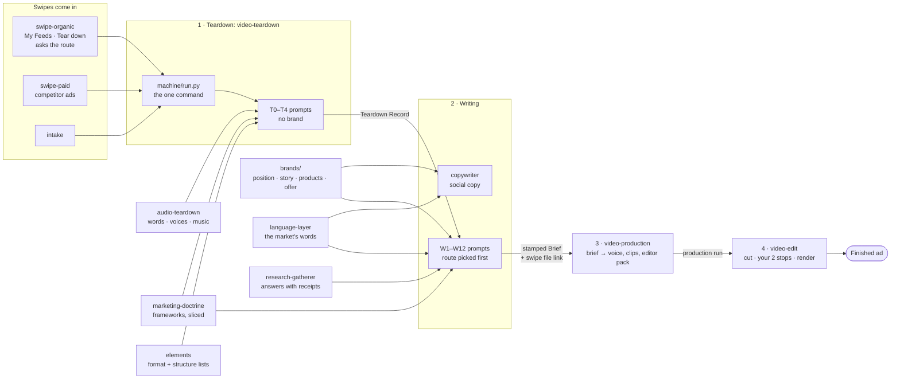

# The Four Stations — how it works (2026-09-30)

Mirror of **The Four Stations** artifact ((team page)), tab *how · How it works*.
One command drives it: `tools/video-teardown/machine/run.py`; it pulls in the helper components at the step that needs them.

## Moved and tested (2026-09-30)
- **Moved:** writing prompts → `tools/copywriter/prompts/video/`; the teardown keeps 0, 1, 1c, 2. Same one command.
- **Test run** (`machine/test_chain_replay.py`, every model answer played back from a real run, no network): creator route 17 steps to her page; AI route 15 steps through the brief and mark used.
- **Hand-offs:** production read the brief from `runs/video-writing/` and checked its stamps; editing read a run from `runs/video-production/` and built its kit.
- **Brief index:** `runs/video-writing/INDEX.md` + `index.json`, one row per brief, rebuilt at every filing.

## One name per station (2026-09-30)
| Station | Component | Runs folder |
|---|---|---|
| 1 Teardown | `tools/video-teardown/` | `runs/video-teardown/` |
| 2 Writing | writing prompts (in video-teardown until the move) | `runs/video-writing/` (new) |
| 3 Production | `tools/video-production/` | `runs/video-production/` (was `video-machine`, repo and Drive) |
| 4 Editing | `tools/video-edit/` | `runs/video-edit/` |

One run, two shelves: what was read off the swipe → video-teardown; everything written for the brand → video-writing; same run name. 740 files from 84 existing runs moved, unedited.

## Inside each component
- **video-teardown** — `machine/` run.py (the one command), chain.py (picks each step's newest prompt), checks swipe_match.py · manifest.py · hook_format.py, transcript.py + deepen.py; `prompts/` one folder per step, highest version runs, older in `archive/`; `notes/`; `context/artifacts.md`.
- **audio-teardown** (T1) — split.py · words.py · speakers.py · voices.py · music.py · effects.py · mix.py → the Sound Sheet.
- **marketing-doctrine** — frameworks.json (the one home), `slices/` (what each step reads), delivery.json, spoken.json, lint checks.
- **elements** — `library/` shared lists (formats, structures…), sources.json; the teardown gets them with our run notes stripped.
- **brands/<brand>** — position.md · story.md · products/ · offer bank · core-avatars/ (language banks, used lane) · variables/video.md.
- **language-layer + research-gatherer** — the market's own words per step; research answered with a permalink or left [UNFILLED].
- **copywriter** — machine/copy.py · prompts/ (stages 0–9) · bank/ · library/; takes on the writing prompts when the move happens.
- **video-production** (station 3) — machine/run.py start (refuses an unstamped brief) · banks/ · formats/ · providers/.
- **video-edit** (station 4, moved to components/ 2026-09-30) — machine/run.py from-run · steps.json · looks/ · prompts/.

## Where a run leaves its files
| Station | Run folder |
|---|---|
| Teardown | `runs/video-teardown/<brand>/<run>/` |
| Writing | `runs/video-writing/<brand>/<run>/` — the brief is in `deliverable/` |
| Production | `runs/video-production/<brand>/<label>/` |
| Editing | `runs/video-edit/<brand>/<label>/deliverable/` |
| Social copy | `runs/copywriter/<brand>/<label>/` |

## Chain check, 2026-09-30
Both brands, every route (`dryrun.resolve`): every step finds its prompt and every input; the only blanks are per-run values (brand_name, video_count, declared_audience). Found: the dry run rewrites `runs/casting/<brand>/CAST.md` — a "nothing is written" run that writes; flagged.
